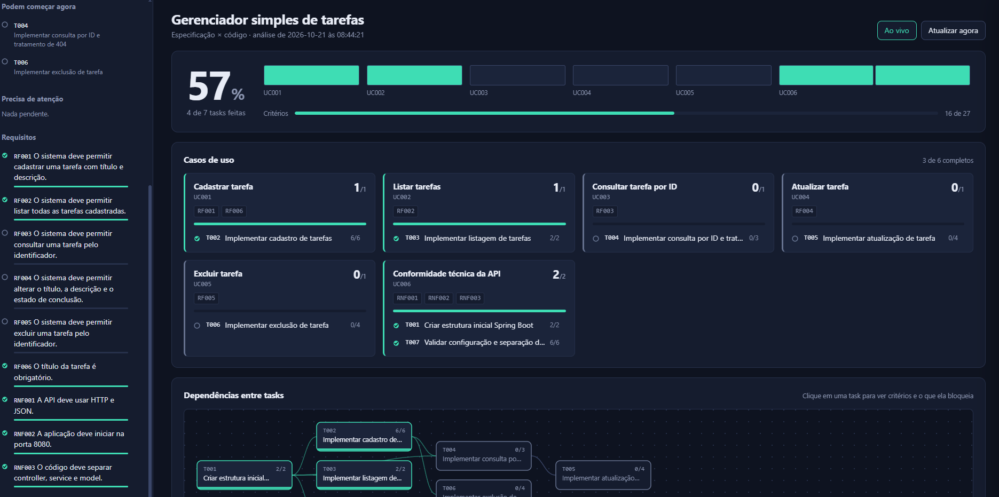
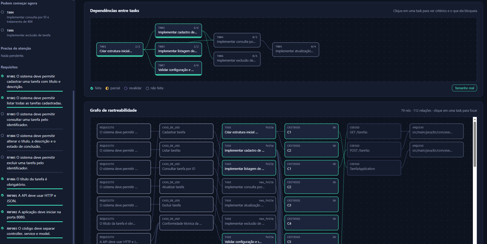
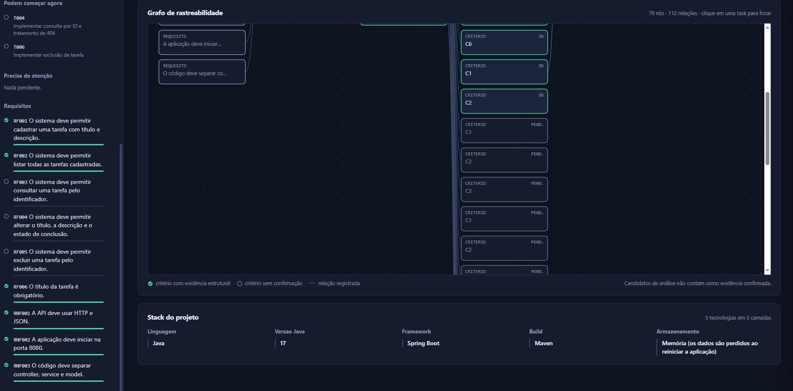

<div align="center">

# SoftTracker

### Da especificação ao código — com rastreabilidade, grafo e testes reais.

**Descubra o que já foi implementado, o que ainda falta e quais testes precisam ser reexecutados.**


[Visão geral](#-o-que-é-o-softtracker) · [Instalação](#-comece-em-5-minutos) · [Dashboard](#-conheça-o-dashboard) · [Comandos](#-comandos-do-dia-a-dia) · [Testes](#-validação-com-testes-reais) · [Ajuda](#-solução-de-problemas)

</div>

---

## 👋 O que é o SoftTracker?

O **SoftTracker** é uma ferramenta local de rastreabilidade de software. Ele conecta a **especificação** de um sistema ao **código-fonte**, organiza essas conexões em um **grafo** e, quando configurado, associa critérios a **testes automatizados**.

A ideia é responder perguntas que costumam consumir tempo durante o desenvolvimento:

- Quais requisitos e funcionalidades parecem já estar implementados?
- Quais tarefas ainda têm critérios sem evidência?
- Que partes do código estão relacionadas a uma tarefa?
- Quais tarefas dependem de outras e podem começar agora?
- Depois de uma alteração, quais testes precisam ser executados novamente?

> **Importante:** encontrar uma classe, função ou rota é uma evidência estrutural — não é, por si só, prova de que o comportamento funciona. O SoftTracker separa a análise estática da validação comportamental para evitar essa confusão.

## ✨ O que você pode fazer

| Recurso | Para que serve |
|---|---|
| 📋 **Rastrear requisitos** | Relacionar requisitos, casos de uso, tarefas e critérios de aceitação. |
| 🔎 **Analisar o código** | Indexar arquivos, símbolos, funções, classes e rotas reconhecíveis. |
| 🕸️ **Explorar o grafo** | Visualizar relações e dependências, incluindo evidências ligadas a critérios. |
| ⚡ **Reaproveitar análises** | Usar hashes e cache incremental para identificar mudanças relevantes. |
| 🧪 **Executar testes configurados** | Registrar resultados comportamentais e sinalizar resultados desatualizados. |
| 🎯 **Revalidar seletivamente** | Executar testes ainda não aprovados ou cujas evidências mudaram, quando a configuração permite filtrar por ID. |
| 🖥️ **Consultar um dashboard local** | Acompanhar progresso, pendências, critérios, relações e estado dos testes. |
| 🔒 **Manter o projeto sob seu controle** | Escolher explicitamente o único projeto monitorado pela configuração ativa. |

## 🖼️ Conheça o dashboard

As imagens a seguir mostram a interface do SoftTracker e como os dados são apresentados. **As capturas foram feitas em uma execução anterior com um projeto Java de exemplo**; os números, tarefas e a stack exibidos são ilustrativos e não vêm incluídos na distribuição limpa. O pacote começa sem projeto-alvo configurado.

### 1. Visão geral do projeto

O topo resume o progresso de tarefas e critérios. A área de casos de uso ajuda a localizar rapidamente os grupos funcionais que estão completos ou ainda precisam de trabalho.



### 2. Dependências entre tarefas

O grafo de dependências ajuda a entender a ordem de implementação. As tarefas bloqueadas ficam visíveis e você pode consultar quais dependências precisam ser concluídas primeiro.



### 3. Grafo de rastreabilidade e stack

O grafo detalha como requisitos, casos de uso, tarefas, critérios e elementos do código se conectam. A seção de stack resume as tecnologias reconhecidas ou descritas na especificação.



## 🚀 Comece em 5 minutos

### 1. Pré-requisitos

- **Python 3.9 ou superior**. A versão empacotada foi exercitada com Python 3.13.5; outras versões não foram todas validadas.
- Um projeto de software existente para monitorar.
- Uma especificação YAML ou JSON que descreva **esse mesmo projeto**.
- Para especificações YAML: instale `PyYAML`. Especificações JSON usam apenas a biblioteca padrão do Python.
- Para executar testes comportamentais: o runner de testes usado pelo projeto-alvo e uma configuração explícita do SoftTracker.

Confira a instalação do Python:

```bash
python --version
```

No Windows, também pode funcionar:

```powershell
py -3 --version
```

### 2. Extraia o projeto e abra um terminal

Baixe ou clone este repositório e entre na pasta onde está `harness.py`:

```bash
cd SoftTracker
```

Opcionalmente, crie um ambiente virtual para isolar as dependências:

**Windows — PowerShell**

```powershell
python -m venv .venv
.\.venv\Scripts\Activate.ps1
```

**macOS / Linux**

```bash
python3 -m venv .venv
source .venv/bin/activate
```

Se você usa uma especificação `.yaml` ou `.yml`, instale o leitor de YAML:

```bash
python -m pip install pyyaml
```

Se a sua especificação for `.json`, pule essa instalação.

### 3. Escolha o projeto e a especificação

A distribuição é intencionalmente **genérica**: ela não inclui um projeto de demonstração nem aponta para um diretório de código predefinido. Escolha o diretório do projeto e a especificação correspondente.

Exemplo no Windows:

```powershell
python harness.py init --projeto "C:\caminho\meu-projeto" --spec "C:\caminho\especificacao.yaml"
```

Exemplo no macOS / Linux:

```bash
python harness.py init --projeto "/home/voce/projetos/meu-projeto" --spec "/home/voce/documentos/especificacao.yaml"
```

Substitua os caminhos pelos seus caminhos reais. Eles podem ser absolutos ou relativos ao diretório atual do terminal. Você pode informar mais de uma especificação após `--spec`, desde que todas descrevam **o mesmo projeto-alvo**.

O comando cria `harness.json`, que registra o projeto ativo e os arquivos de especificação. O estado gerado fica em `estado/`. Esses arquivos são locais e não são distribuídos no pacote inicial.

### 4. Valide, sincronize e veja o status

Execute estes comandos na pasta do SoftTracker:

```bash
python harness.py validar
python harness.py sync
python harness.py status --resumo
```

Se a validação terminar sem erros, abra o dashboard:

```bash
python harness.py painel
```

O navegador abrirá em `http://localhost:8765`. Para usar outra porta ou impedir a abertura automática:

```bash
python harness.py painel --porta 8766 --sem-abrir
```

Depois, abra manualmente `http://localhost:8766`.

No Windows, após configurar o projeto, você também pode iniciar o painel com `iniciar_dashboard.bat`.

## 🧾 Como preparar a especificação

O SoftTracker aceita YAML (`.yaml`/`.yml`) e JSON. A especificação deve representar o projeto que você escolheu monitorar e ter **IDs estáveis** para requisitos, casos de uso, tarefas e critérios.

Abaixo está um exemplo mínimo em YAML. Adapte os nomes e os critérios ao seu sistema:

```yaml
projeto:
  nome: "Minha aplicação"
  stack:
    - camada: "Backend"
      itens:
        - "Node.js"
        - "Express"

requisitos:
  - id: RF001
    titulo: "A API deve permitir cadastrar um item"
    tipo: funcional

casos_de_uso:
  - id: UC001
    titulo: "Cadastrar item"
    requisitos: [RF001]

tasks:
  - id: T001
    titulo: "Implementar cadastro de itens"
    casos_de_uso: [UC001]
    depende_de: []
    criterios:
      - id: C1
        descricao: "A API aceita dados válidos para criar um item"
        artefato:
          tipo: rota
          padrao: "POST /items"
      - id: C2
        descricao: "A API rejeita os dados obrigatórios ausentes"
        artefato:
          tipo: funcao
          padrao: "criarItem"
```

### Boas práticas para critérios

- Prefira resultados **observáveis e verificáveis**. Exemplo: “retorna HTTP 404 quando o identificador não existe”, em vez de “trata erros corretamente”.
- Não reutilize o mesmo ID para requisitos ou tarefas diferentes. IDs de critérios precisam ser únicos dentro da tarefa a que pertencem.
- Declare dependências reais em `depende_de`; não crie dependências apenas para ordenar visualmente o painel.
- Use `artefato` como uma pista de rastreabilidade. Um padrão encontrado não comprova sozinho que toda a regra de negócio está correta.
- Se o critério depender de um método específico, use um escopo apropriado quando o tipo de artefato e as regras da especificação permitirem.
- `tasks` é o formato recomendado. O formato legado `tarefas_desenvolvimento` também é normalizado, mas uma especificação válida deve conter tarefas e critérios de aceitação.

### Tipos de artefato

| Tipo | Uso típico |
|---|---|
| `rota` | Endpoint HTTP, incluindo método e caminho, conforme a linguagem/framework reconhecidos. |
| `funcao` | Função ou método que participa do comportamento. |
| `classe` | Classe ou componente estrutural. |
| `arquivo` | Arquivo específico relacionado ao critério. |
| `simbolo` | Símbolo reconhecido pelo indexador. |
| `conteudo` | Padrão textual; pode usar `escopo` para restringir a busca a uma função, classe, rota ou símbolo. |

## 🧭 Entenda o status

O SoftTracker exibe a situação da implementação e, quando configurado, a situação dos testes comportamentais. São informações diferentes.

| Estado da implementação | O que significa |
|---|---|
| **Feita** | Os critérios foram considerados atendidos pelas evidências registradas segundo as regras configuradas. |
| **Parcial** | Parte dos critérios tem evidências, mas há critérios sem confirmação. |
| **Não feita / sem evidência** | A análise atual não encontrou evidência suficiente para confirmar os critérios. Isso não prova que o código inexiste. |
| **Revalidar** | Evidências anteriormente consideradas válidas mudaram e precisam ser revistas. |

Os testes comportamentais podem ter estados como **aprovado**, **falhou**, **não executado** ou **desatualizado**. Código presente com teste falho não deve ser interpretado como comportamento funcional comprovado.

## 🧰 Comandos do dia a dia

Execute os comandos na pasta do SoftTracker, depois de configurar o projeto.

| Comando | O que faz |
|---|---|
| `python harness.py validar` | Valida a estrutura da especificação e a configuração de testes. |
| `python harness.py sync` | Atualiza índice, vínculos, evidências e grafo. |
| `python harness.py status` | Sincroniza com o código atual e exibe os detalhes das tarefas e critérios. |
| `python harness.py status --resumo` | Mostra um resumo do progresso. |
| `python harness.py status --json` | Emite o status completo em JSON. |
| `python harness.py proxima` | Lista as tarefas cujas dependências permitem começar. |
| `python harness.py go T001` | Abre a tarefa indicada; o curador informa dependências pendentes. Troque `T001` por um ID real. |
| `python harness.py pendentes` | Lista critérios que ainda precisam de julgamento e candidatos de código. |
| `python harness.py pendentes --json` | Exibe pendências em JSON. |
| `python harness.py trecho "ID_DO_NO"` | Mostra o trecho de código associado a um nó existente. |
| `python harness.py link T001/C1 "ID_DO_NO"` | Registra um vínculo manual entre critério e nó de código existente. |
| `python harness.py nao-feito T001/C1` | Registra que os candidatos atuais não comprovam o critério. |
| `python harness.py unlink T001/C1` | Remove o julgamento manual desse critério. |
| `python harness.py watch` | Observa mudanças e sincroniza periodicamente; interrompa com `Ctrl+C`. |
| `python harness.py testar` | Executa os testes comportamentais explicitamente configurados. |
| `python harness.py testar --impactados` | Executa os testes que precisam ser validados novamente, desde que a configuração suporte filtragem. |

**Dica:** use IDs reais da sua especificação. Para escolher um nó de código para `link`, consulte as pendências ou `estado/codigo.json`; não invente IDs.

Para consultar todas as opções:

```bash
python harness.py --help
python harness.py init --help
python harness.py link --help
python harness.py testar --help
```

## 🧪 Validação com testes reais

A execução comportamental é **opcional e vem desabilitada por padrão**. Para habilitá-la, configure a seção `testes` em `harness.json` e associe IDs de testes aos critérios com `verificacao.testes`.

Exemplo do formato de configuração — adapte o comando e os caminhos ao runner usado pelo seu projeto:

```json
{
  "testes": {
    "habilitado": true,
    "comando": ["COMANDO_DO_TEST_RUNNER", "ARGUMENTOS", "{pattern}"],
    "formato": "junit",
    "diretorio": ".",
    "arquivos": ["caminho/para/testes"],
    "timeout_segundos": 60,
    "env": {}
  }
}
```

O comando precisa emitir **JUnit XML reconhecível na saída padrão**. O campo `arquivos` lista arquivos relevantes para que mudanças nos próprios testes invalidem os resultados associados. Para permitir filtragem com `testar --impactados`, o comando deve aceitar o marcador `{pattern}` no argumento apropriado e usar esse padrão para selecionar os IDs de teste.

Na especificação, associe o critério ao ID exato do teste, por exemplo:

```yaml
criterios:
  - id: C3
    descricao: "Consultar um ID inexistente retorna HTTP 404"
    verificacao:
      obrigatoria: true
      testes:
        - "api.tasks.id_inexistente_retorna_404"
```

Depois de configurar e validar:

```bash
python harness.py validar
python harness.py testar
python harness.py status --json
python harness.py testar --impactados
```

`status` não executa os testes: ele mostra os resultados registrados e sinaliza quando estão desatualizados. A reexecução é explícita. Use apenas comandos de teste confiáveis, pois eles executam código do projeto-alvo no seu computador.

> O executor atualmente espera relatórios JUnit XML na saída padrão. Alguns runners escrevem relatórios em arquivos ou usam outro formato; nesses casos, será necessário adaptar a configuração ou criar um pequeno adaptador. A filtragem seletiva depende do suporte do runner ao padrão recebido.

## 🕸️ Como o grafo ajuda

O grafo não serve apenas para desenhar relações no dashboard. Ele também ajuda o SoftTracker a navegar por evidências já conhecidas e identificar quais critérios ou testes podem ter sido afetados por mudanças.

O modelo, em alto nível, é:

```text
Requisito
   ↓
Caso de uso
   ↓
Tarefa ──→ Critérios de aceitação
                  ↓
           Código e símbolos
                  ↓
             Testes ligados
```

Com hashes e cache incremental, arquivos e evidências que continuam iguais podem ser reaproveitados. Quando algo muda, o sistema recalcula o estado e marca resultados afetados para revalidação. O grafo de chamadas é uma aproximação estática: frameworks dinâmicos, injeção de dependências e lógica distribuída podem exigir revisão manual ou testes mais abrangentes.

## 📁 Arquivos e estado local

Depois da inicialização, você verá arquivos gerados como:

```text
SoftTracker/
├── harness.py             # CLI principal
├── harness.json           # configuração do projeto ativo (gerada pelo init)
├── sddtrack/              # indexador, grafo, motor e executor de testes
├── painel/                # interface web local
├── docs/images/           # capturas utilizadas neste README
└── estado/                # índice, status, vínculos e resultados (gerado localmente)
```

`harness.json` e `estado/` são específicos da sua configuração e estão no `.gitignore`. Não versionamos esses dados por padrão para evitar publicar caminhos locais ou misturar resultados entre máquinas/projetos.

Uma configuração monitora **um único projeto-alvo**. Para mudar o alvo, execute `init` novamente com o novo diretório e sua especificação. O estado gerado padrão anterior é removido quando o comando detecta a troca de projeto, para não misturar os grafos, vínculos e resultados.

## 🔐 Segurança e privacidade

- O painel é servido em `127.0.0.1` e destina-se ao uso local.
- A execução de testes não acontece automaticamente; habilite-a explicitamente em `harness.json`.
- Comandos de teste são executados sem `shell=True`, têm timeout e rodam dentro do diretório configurado do projeto.
- Revise os comandos que você configurar antes de executá-los: testes podem acessar recursos e modificar arquivos conforme o próprio código de teste.
- A integração opcional com IA não é necessária para a análise estática básica. Não ative integrações externas sem compreender os dados enviados e as credenciais envolvidas.

## 🛠️ Solução de problemas

<details>
<summary><strong>“Configuração ausente” ou o projeto ainda não foi configurado</strong></summary>

Execute `python harness.py init --projeto "CAMINHO_DO_PROJETO" --spec "CAMINHO_DA_ESPECIFICACAO.yml"` na pasta do SoftTracker. Confira se ambos os caminhos existem.

</details>

<details>
<summary><strong>Erro ao ler YAML / “instale PyYAML”</strong></summary>

Ative o ambiente Python que está usando e execute `python -m pip install pyyaml`. Alternativamente, use uma especificação JSON.

</details>

<details>
<summary><strong>“Nenhuma task reconhecida” ou tarefa sem critérios</strong></summary>

Confira se a especificação usa `tasks` (recomendado) ou o formato legado `tarefas_desenvolvimento`, e se cada tarefa tem ID e ao menos um critério com descrição.

</details>

<details>
<summary><strong>O critério aparece como não feito, mesmo com código relacionado</strong></summary>

O indexador usa regras estáticas; nomes parecidos não garantem correspondência. Rode `python harness.py pendentes`, inspecione os candidatos e trechos, revise o escopo do critério e, se a relação estiver correta, registre-a com `link` usando um ID de nó existente. Depois rode `status` novamente.

</details>

<details>
<summary><strong>O teste aparece como não executado ou desatualizado</strong></summary>

Confirme `testes.habilitado: true`, o comando e diretório do runner, a emissão de JUnit XML, os IDs exatos em `verificacao.testes` e a lista de arquivos de teste. Execute `python harness.py testar` para a suíte configurada ou `python harness.py testar --impactados` para a execução seletiva compatível.

</details>

<details>
<summary><strong>A porta 8765 já está em uso</strong></summary>

Inicie o dashboard em outra porta: `python harness.py painel --porta 8766`. Acesse `http://localhost:8766`.

</details>

## 🤝 Contribuições

Sugestões, relatos de erros e contribuições são bem-vindos. Ao abrir uma issue, descreva:

1. O que você tentou fazer e o que esperava que acontecesse.
2. O comando executado e a mensagem de erro completa (remova caminhos ou dados sensíveis).
3. A linguagem/framework do projeto monitorado e um exemplo mínimo que reproduza o problema.

Para mudanças que afetem a rastreabilidade, prefira incluir um exemplo reproduzível e explicar qual critério deve ser marcado como atendido, parcial ou pendente.

## 📄 Licença

Este projeto está disponível sob a licença [MIT](LICENSE).

---

<div align="center">

**Especificação → Código → Evidências → Testes**

*O SoftTracker ajuda a enxergar o progresso. A revisão semântica e os testes continuam sendo essenciais para comprovar o comportamento.*

</div>
